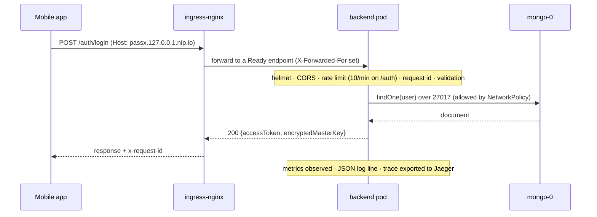
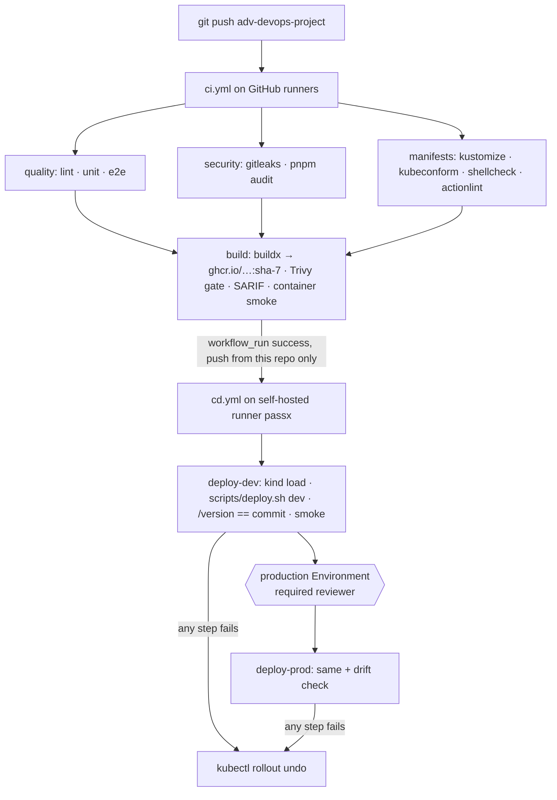

# PassX architecture

PassX is a zero-knowledge password manager. The mobile app encrypts everything on the device; the backend only ever stores ciphertext. This document covers the backend as it runs on Kubernetes, the path a user request takes, the path a commit takes, and where things fail.

## Components

```mermaid
flowchart LR
  subgraph Client
    App[Expo mobile app]
  end
  subgraph kind cluster "passx"
    subgraph ns_ingress[ns ingress-nginx]
      ING[ingress-nginx<br/>hostPort 80/443]
    end
    subgraph ns_app[ns passx-dev / passx-prod]
      SVC[Service backend<br/>3000 http · 9464 metrics]
      BE1[backend pod]
      BE2[backend pod]
      MSVC[headless Service mongo]
      MONGO[(mongo-0<br/>StatefulSet + PVC)]
      CM[ConfigMap backend-config<br/>hashed]
      SEC1[Secret backend-secrets<br/>hashed]
      SEC2[Secret mongo-secrets]
    end
    subgraph ns_mon[ns monitoring]
      PROM[Prometheus]
      GRAF[Grafana]
      LOKI[Loki]
      PT[Promtail]
      JAE[Jaeger]
      AM[Alertmanager]
    end
  end
  App -->|HTTPS via nip.io host| ING --> SVC --> BE1 & BE2
  BE1 & BE2 -->|27017, NetworkPolicy| MSVC --> MONGO
  CM & SEC1 & SEC2 -.env.-> BE1 & BE2
  SEC2 -.env.-> MONGO
  PROM -->|scrape 9464| SVC
  PT -->|container logs| LOKI
  BE1 & BE2 -->|OTLP 4317| JAE
  PROM --> AM
  GRAF --> PROM & LOKI & JAE
```

| Component | Kind | Why this shape |
|---|---|---|
| backend | Deployment, 1 (dev) or 2–4 (prod, HPA) replicas | Stateless API; rolling update with `maxUnavailable: 0`; three probes |
| mongo | StatefulSet, 1 replica, 1 Gi PVC | Needs a stable identity and its own volume; one replica is enough for a demo cluster |
| ingress-nginx | Helm chart on host ports | The only entry point; `/metrics` and probes are not routed |
| ConfigMap / Secrets | Kustomize generators | Hash suffix on config and JWT secret rolls pods on change; Mongo root secret has a fixed name because it only applies at first init |
| NetworkPolicy | default deny ingress + explicit allows | Mongo only from backend pods; backend 3000 only from ingress-nginx, 9464 only from monitoring; Loki and Jaeger only from their clients |
| monitoring | kube-prometheus-stack, Loki + Promtail, Jaeger all-in-one | Metrics, logs and traces in one Grafana; SLO alerts via PrometheusRule |

## Request path



The backend decrypts nothing. `encryptedMasterKey` and every vault item are opaque blobs the client encrypts with a key derived from the master password on the device.

## Commit to running pod



`GET /version` on the running pod returns the commit, image tag, build time and pipeline run URL baked in at build time, plus pod and node from the downward API. That is the link between a pipeline run and what is serving traffic.

## Failure boundaries

| Failure | What happens | How it is seen |
|---|---|---|
| Mongo unreachable | `/health/ready` returns 503 within 1.5 s; pod leaves the Service endpoints; liveness stays green so no restart loop; backend reconnects on its own | `mongo_up` 0, `PassXMongoDown` alert, readiness events |
| Backend crash or hang | liveness fails, kubelet restarts the container; the other replica keeps serving | restart counter on the dashboard |
| Bad release | new pods never pass readiness; old pods keep serving; `rollout status` times out; pipeline runs `rollout undo` | evidence in `docs/evidence/rollout-and-rollback-local.md` and the CD run |
| Traffic spike (prod) | HPA scales 2→4 at 70% CPU; PDB keeps one pod through voluntary disruption; rate limiting protects `/auth` | HPA panel, 429s in metrics |
| Node pressure | requests/limits on every container decide scheduling and eviction order | kube-state-metrics |
| Secret rotation | JWT: hashed Secret rolls backend pods. Mongo: fixed-name Secret, password must be changed inside Mongo first (see `k8s/README.md`) | `rollout status` |

## Environments

| | dev | prod |
|---|---|---|
| namespace | `passx-dev` | `passx-prod` |
| host | `dev.passx.127.0.0.1.nip.io` | `passx.127.0.0.1.nip.io` |
| replicas | 1 | HPA 2–4, PDB minAvailable 1 |
| log level | debug | info |
| deploy | automatic on green CI | after approval |

Both are rendered from the same Kustomize base; the overlays differ only in namespace, host, replicas/HPA/PDB, and the log level, so there are no drifting copies of the manifests.
