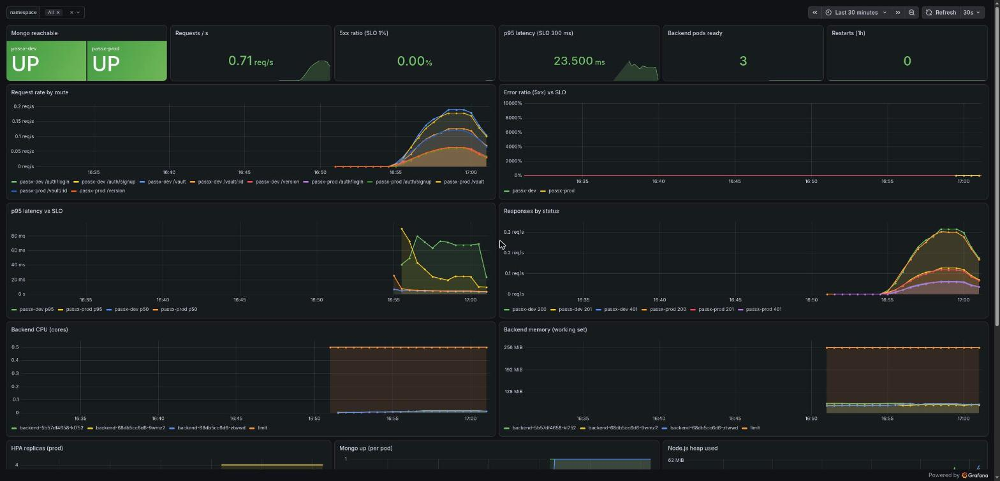
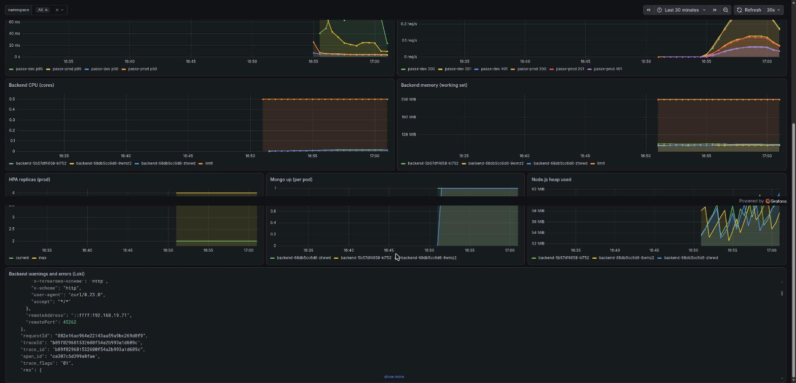
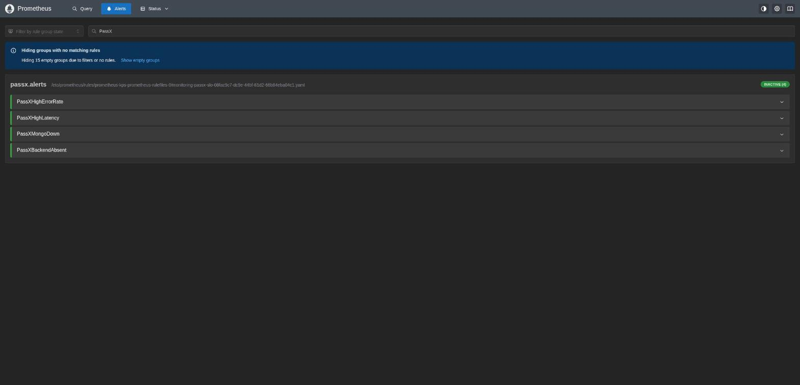
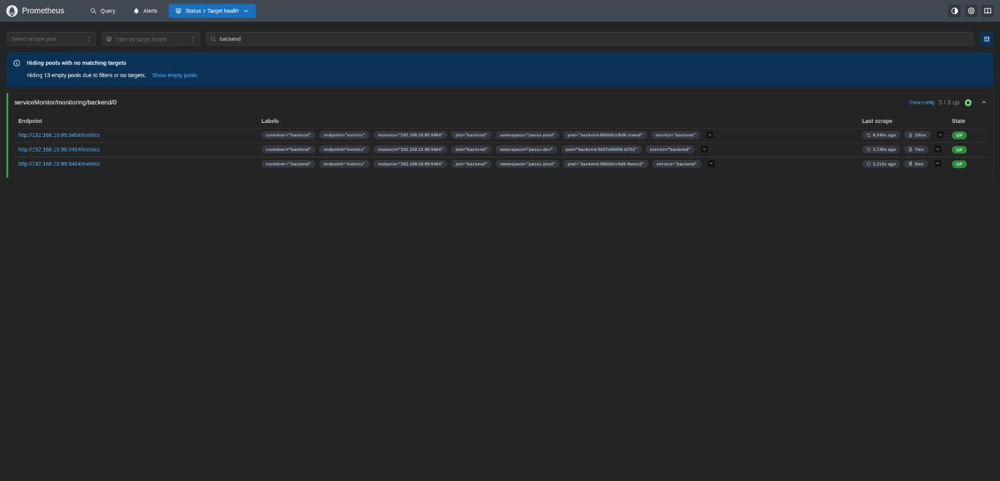
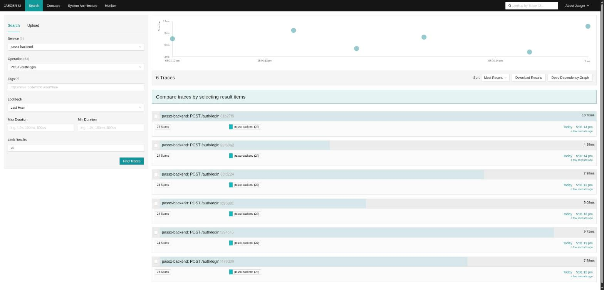
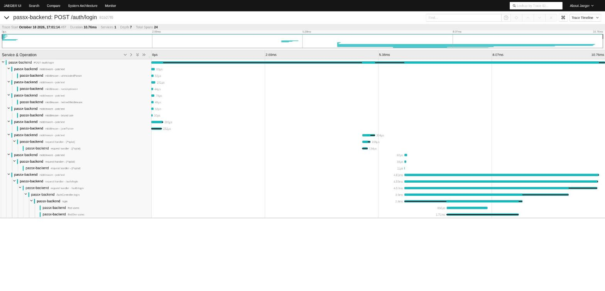
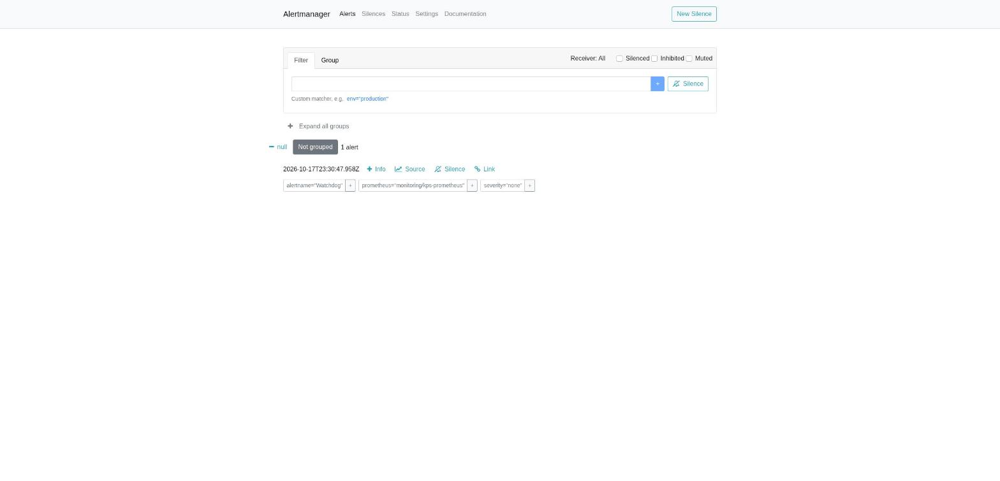

# Evidence index

Every claim in this PR links to a pipeline run, a commit, a command output, or a file in this repository. Screenshots are deliberately secondary; the raw outputs are reproducible with the commands shown.

Baseline commit (before any DevOps work): `f728c2a2593f081628ae695b34db87763ba15943` on `main`.

## 1. Source → image (CI)

`docs/evidence/ci-pipeline.md`: a green run tied to a commit, the image digest, the Trivy gate, the in-pipeline container smoke test, and the registry pull check. Also the earlier failed runs and what each gate caught.

## 2. Image → running pod with approval (CD)

`docs/evidence/cd-approval-deploy.md`: run 39113402610 deployed dev automatically and prod only after `Souvik-Cyclic` approved the `production` Environment; `/version` on both environments returns the commit and the run URL; runner log lines from the laptop.

Further traced releases, same shape, each approved by the same reviewer: run 39113954154 (monitoring stack, commit `2a35d9f`) and run 39115197134 (verification fix, commit `c83bb6b`, the version serving prod at the time of writing).

## 3. A working user journey on the tested version

`scripts/smoke.sh` runs in every deploy job and locally via `make smoke ENV=<env>`: readiness, version, signup, login, vault create/list/update/delete, unauthenticated rejection. Its output appears in the deploy job logs and in `docs/evidence/rollout-and-rollback-local.md`.

## 4. Release control: rolling update and rollback

- `docs/evidence/rollout-and-rollback-local.md`: image-to-image rolling update under a probe loop (146 requests, 0 non-200), a stalled release that never took traffic, `rollout undo`, drift check clean.
- `docs/evidence/pipeline-rollback.md`: the same failure injected through a real commit; the CD job detected the stalled rollout and rolled back without human action (run 39114275555); run 39114842590 shows a rollback caused by a too-eager version check, which was then fixed; the revert redeployed cleanly in run 39115197134.

## 5. Observability and reliability

- Metrics: Prometheus scrapes three backend targets (1 dev, 2 prod) on port 9464; recording rules and four alerts in `k8s/monitoring/manifests/prometheusrule-passx-slo.yaml`; dashboard JSON in `k8s/monitoring/manifests/dashboards/passx-backend.json`.
- Logs: pino JSON in Loki, queryable by `{namespace="passx-prod", app="backend"} | json | level="error"`.
- Traces: Jaeger service `passx-backend` with spans for route, handler, and each Mongo command.
- `docs/evidence/alert-firing-recovery.md`: `PassXMongoDown` firing during a forced outage and resolving after recovery, with readiness 503 shedding traffic in between, and the smoke test passing afterwards.

## 5a. Screenshots (supplementary to the API captures above)

Taken on 18 Oct 2026 from the running cluster via `kubectl port-forward`, with the smoke test generating traffic.

| | |
|---|---|
| Grafana dashboard, top: Mongo up, request rate, 5xx ratio vs 1% SLO, p95 vs 300 ms, pods ready, restarts, per-route rate |  |
| Grafana dashboard, bottom: CPU and memory vs limits, HPA replicas, Mongo up per pod, Node.js heap, Loki panel with request and trace ids |  |
| Prometheus: the four PassX alert rules loaded and inactive |  |
| Prometheus: three backend scrape targets up (1 dev, 2 prod) on port 9464 via the ServiceMonitor |  |
| Jaeger: `POST /auth/login` traces for `passx-backend` |  |
| Jaeger: one login trace, 24 spans, from Express middleware through `AuthController.login` to the Mongo `find`/`findOne` commands |  |
| Alertmanager: only the Watchdog heartbeat active (no receiver configured, see limitations) |  |

## 6. Security

- Secrets: none in git (`gitleaks` job on full history, clean; `.gitignore` for `secrets.env`, `mongo.env`, `grafana.env`; GitHub Environment secrets written to the runner workspace at deploy time and deleted afterwards). One Grafana password was committed by mistake during this work, caught by GitGuardian and the gitleaks job, rotated within minutes, and removed from the branch history; see `docs/evidence/ci-pipeline.md`.
- Runtime: non-root uid 1000, read-only root filesystem, dropped capabilities, seccomp, no service-account token, `restricted` Pod Security Standard on both namespaces, NetworkPolicies enforced by Calico (`make netpol-test` output in `k8s/README.md`), metrics port not routed by the Ingress.
- Delivery: Trivy gate on the image, `pnpm audit` gate on dependencies, actions pinned to commit SHAs, CD reachable only from push builds in this repository, production behind a required reviewer.

## 7. How to reproduce everything

`docs/runbook.md`. Short form:

```
make cluster-up
make secrets ENV=dev && make secrets ENV=prod
make image load deploy ENV=dev && make smoke ENV=dev
make deploy ENV=prod && make smoke ENV=prod
make monitoring-up
```

## Known limitations

Listed in `docs/runbook.md` and `docs/decisions.md`: single node and single Mongo replica, per-pod rate limits, CSP disabled for Swagger, in-memory Jaeger, no Alertmanager receiver, Prometheus/Alertmanager UIs open inside the cluster, images pulled by tag rather than digest.
